# RecentViewsCounter 近期访问统计插件

## 功能特性

- 📊 记录每篇文章的详细访问信息
- 🌍 自动获取访客IP归属地信息
- 📈 显示最近一个月访问量排行榜
- 📅 提供每日访问趋势图表
- 📆 月度访问统计和历史数据保存
- 👥 统计独立访客数量
- 🔍 详细的访问记录查看
- 📋 文章访问记录详情查看功能
- 🌐 IP访问统计和地域分布分析
- 🔎 IP访问详情查看，支持查看每个IP的完整访问历史
- 🤖 智能识别搜索引擎爬虫访问
- 🛡️ 访问频率限制和防刷量保护
- 📊 访问来源统计和分析（搜索引擎、社交媒体、外部链接等）
- 💾 本地IP归属地数据库，减少外部API依赖
- ⚡ 异步IP查询机制，不影响页面加载速度
- 🔄 多IP查询接口支持（IP138、ip-api.com等）
- ⚙️ 灵活的配置选项
- 🗂️ 完善的数据管理和清理功能

## 数据记录

插件会为每次访问记录以下信息：
- 文章ID (cid)
- 访问时间戳 (visit_time)
- 访客IP地址 (ip)
- IP归属地 (location)
- 用户代理字符串 (user_agent)

## 主要功能
启用插件后，在"近期统计"页面可以查看以下数据：
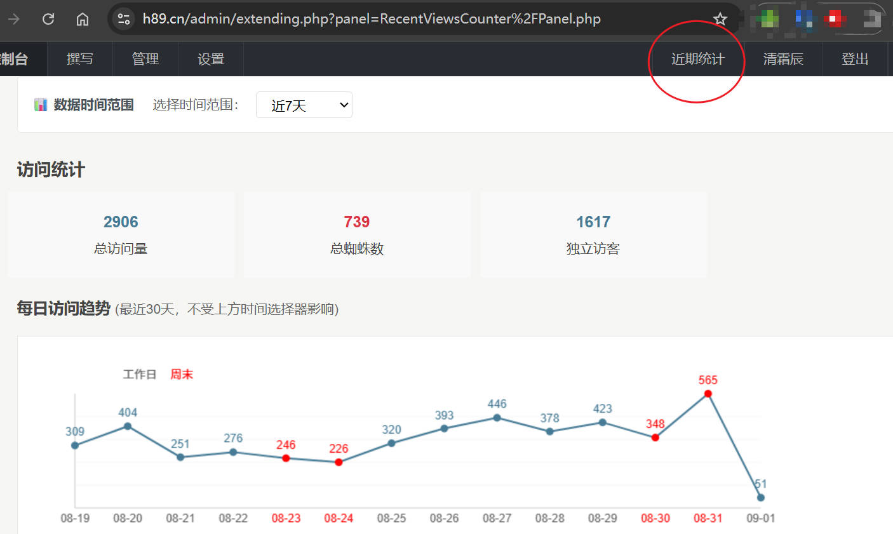

### 1. 访问统计
- 自动记录文章访问信息
- 防止同一IP短时间内重复统计
- 排除管理员访问

### 2. 数据展示
- 近期总访问量
- 近期独立访客数
- 今日访问量
- 搜索引擎爬虫访问统计
- 访问趋势图
- **月度访问统计**: 显示最近24个月的访问趋势折线图，包含总访问量和独立访客数

### 3. 热门文章
- 显示最近一个月访问量前N的文章
- 提供文章标题、访问次数、链接
- 支持直接跳转到文章编辑页面
- **文章访问记录**: 每篇文章都可查看详细的访问记录，包括访问时间、IP地址、User Agent、归属地等信息

### 4. 详细统计
- 单篇文章的详细访问记录
- 按日期和IP的访问统计
- 访客地理位置分布
- 访问最多的IP地址排行榜（前20名）
- IP访问次数和占比统计
- **IP访问详情查看**: 点击IP地址可查看该IP的详细访问记录，包括访问的文章、时间、User Agent等信息

### 5. IP统计和爬虫识别
- **地域分布统计**: 自动统计访客来源地区，显示前10个访问量最高的地区
- **IP访问排行**: 展示访问次数最多的前20个IP地址，包含归属地信息
- **访问占比分析**: 计算每个IP的访问占比，便于识别异常访问
- **IP访问详情**: 为每个IP提供"查看详情"功能，可查看该IP访问的所有文章记录
- **详细访问信息**: 包含访问时间、文章标题、User Agent、归属地等完整信息
- **智能爬虫识别**: 自动识别主流搜索引擎爬虫（Google、百度、Bing等）
- **爬虫访问统计**: 单独统计爬虫访问次数，与正常用户访问区分
- **支持爬虫类型**: Googlebot、Baiduspider、Bingbot、Slurp、DuckDuckBot、YandexBot等30+种爬虫

## 配置选项

- **IP归属地查询**: 启用/禁用IP地理位置查询
- **IP138 API Token**: IP138接口的访问令牌，留空将使用默认token
- **本地IP数据库**: 启用/禁用本地IP归属地数据库，优先从本地查询以提高性能
- **IP归属地缓存天数**: 本地IP归属地数据的缓存天数
- **自动清理IP数据**: 启用/禁用自动清理过期的IP归属地数据
- **异步IP查询**: 自动启用，优先从本地缓存查询，异步更新未缓存的IP归属地
- **访问频率限制**: 启用/禁用高频访问拦截功能，防止恶意刷量
- **限流窗口时间**: 统计访问频率的时间窗口（秒）
- **限流阈值**: 在窗口时间内允许的最大访问次数
- **热门文章数量**: 设置显示的热门文章数量
- **重复访问间隔**: 防止刷量的时间间隔设置
- **自动清理过期记录**: 启用/禁用自动清理功能
- **记录保留天数**: 设置访问记录的保留天数
- **启用缓存**: 启用/禁用热门文章列表缓存功能
- **缓存更新间隔**: 设置缓存文件的更新间隔时间（秒）
- **缓存文件位置**: 设置缓存文件的存放路径
- **访问来源统计**: 启用/禁用访问来源统计功能

## 截图展示

### 应用设置界面
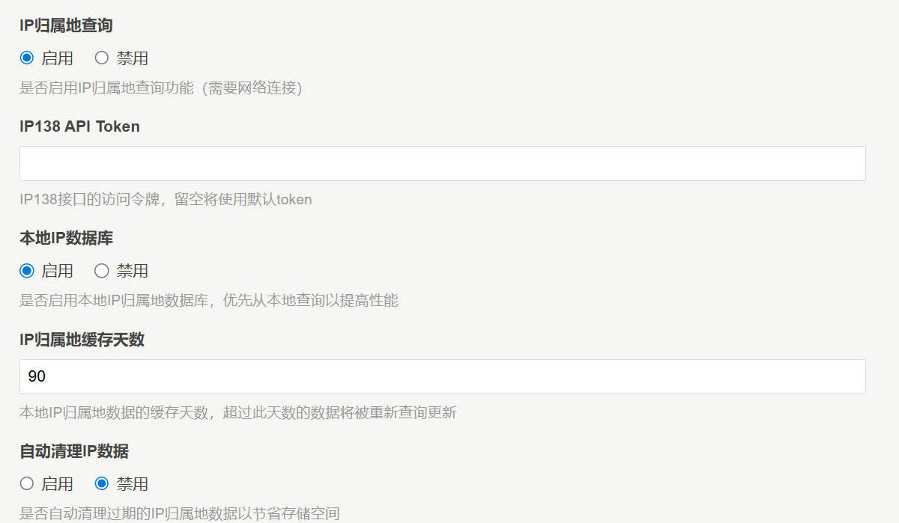
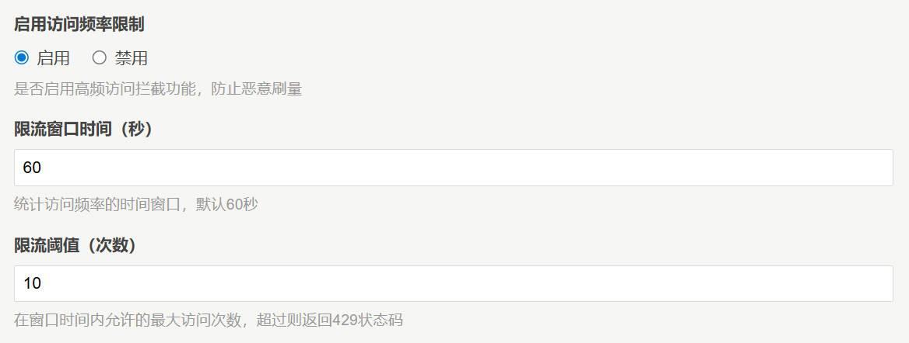
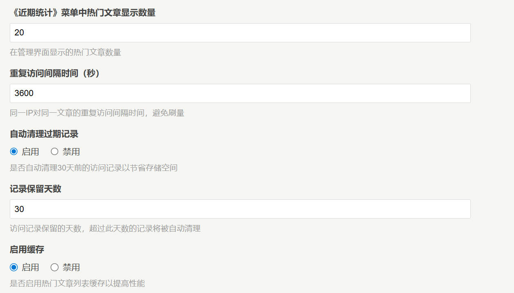
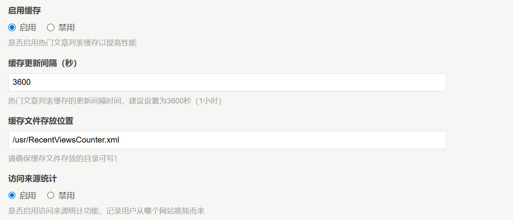

### 访问统计概览
- 显示近期总访问量、独立访客数、搜索引擎爬虫访问统计 
- 实时数据更新
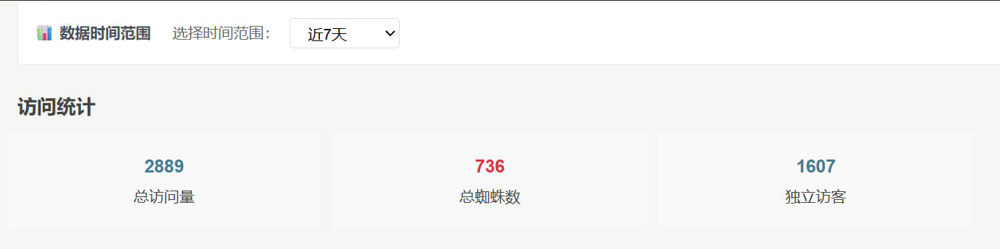

### 每日访问趋势图
- 最近30天的访问趋势折线图
- 周末和工作日颜色区分显示
- 数据点和时间轴清晰标注
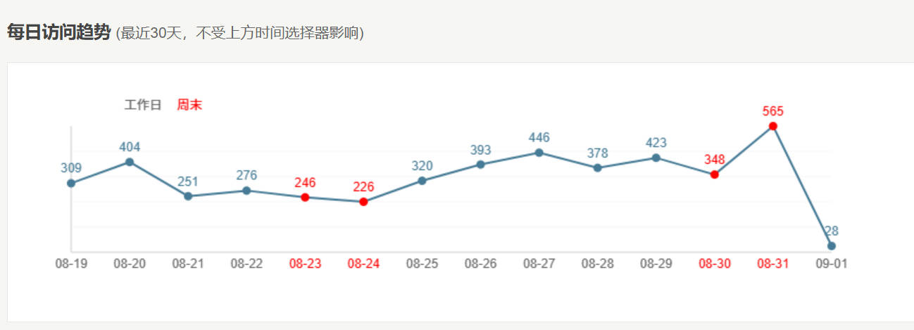

### 月度访问统计
- 最近24个月的访问趋势
- 总访问量和独立访客数对比
- 历史数据完整保存
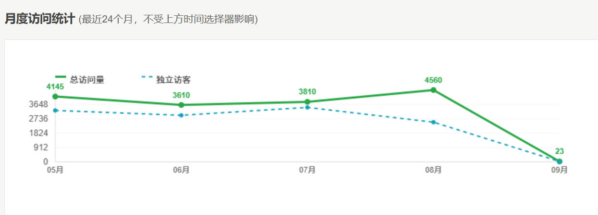

### 热门文章排行
- 近期访问量排行榜
- 文章标题、访问次数、直接链接
- 支持查看详细访问记录
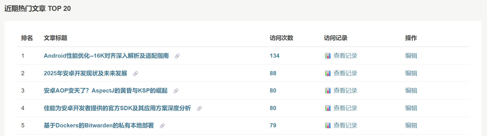

### IP统计和地域分布
- 访问最多的IP地址排行
- 地域分布统计分析
- 访问来源分析
- IP访问详情查看功能
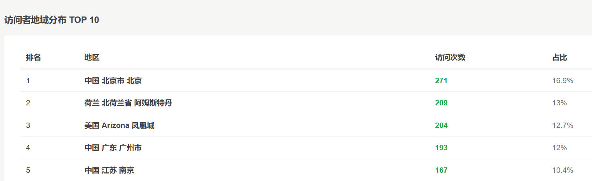
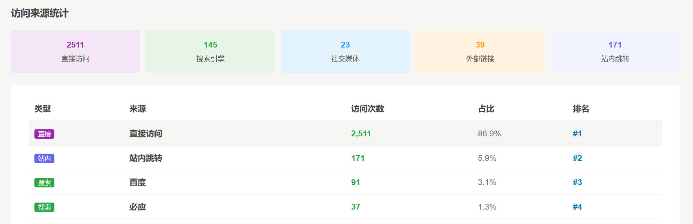

### 爬虫识别统计
- 智能识别30+种搜索引擎爬虫
- 爬虫访问次数统计
- 与正常用户访问区分显示
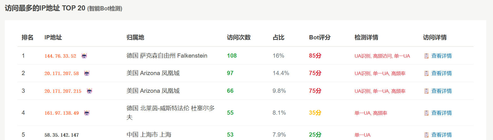

### 近期访问最多列表
参见 <https://h89.cn/> 右侧"近期热门"

## 使用方法

1. 将当前项目所有文件放文件夹RecentViewsCounter，上传到typecho的 `usr/plugins/` 目录
2. 在后台插件管理中激活插件RecentViewsCounter
3. 在管理菜单中点击"近期统计"查看数据
4. 根据需要调整插件配置
5. 查看IP统计、地域分布、爬虫访问等详细数据
6. **查看文章访问记录**: 在"近期热门文章"列表中点击"访问记录"查看单篇文章的详细访问信息
7. **查看IP访问详情**: 在"访问最多的IP地址"列表中点击"查看详情"查看该IP的完整访问历史
8. 使用数据管理功能清理过期记录和缓存

## 主题集成

### 在侧边栏显示近期热门文章

如果您想在主题的侧边栏中显示近期热门文章，可以在主题的 `sidebar.php` 文件中添加以下代码：

```php
<?php
// 近期热门功能 -https://github.com/chenjim/RecentViewsCounter
if (class_exists('RecentViewsCounter_Plugin')) {
    echo RecentViewsCounter_Plugin::renderRecentHotArticles(8, $this, '近期热门', '暂无近期热门文章');
}
?>
```

效果参见 <https://h89.cn/>

### 代码说明

- `class_exists('RecentViewsCounter_Plugin')`: 检查插件是否已激活
- `getTopArticlesThisMonth(8)`: 获取近期访问量前8的文章，可根据需要调整数量
- `Typecho_Db::get()`: 获取数据库连接，用于查询文章完整信息
- `Typecho_Router::url()`: 生成正确的文章链接
- `htmlspecialchars()`: 防止XSS攻击，安全显示文章标题

### 自定义样式

您可以通过CSS自定义热门文章列表的样式：

```css
.widget-list li {
    margin: 5px 0;
    line-height: 1.6;
}

.widget-list a {
    text-decoration: none;
    color: #333;
}

.widget-list a:hover {
    color: #0066cc;
}
```

## API接口

### 获取文章月度访问量
```php
RecentViewsCounter_Plugin::getMonthlyViews($cid);
```

### 获取热门文章列表
```php
RecentViewsCounter_Plugin::getTopArticlesThisMonth($limit);
```

### 获取带完整信息的热门文章列表
```php
RecentViewsCounter_Plugin::getTopArticlesWithFullInfo($limit, $widget);
```

### 渲染近期热门文章HTML（一键调用）
```php
RecentViewsCounter_Plugin::renderRecentHotArticles($limit, $widget, $title, $emptyText);
```

### 获取访问来源统计
```php
RecentViewsCounter_Plugin::getRefererStats($days);
```

### 获取IP归属地信息
```php
RecentViewsCounter_Plugin::getIpLocation($ip);
```

### 异步更新IP归属地信息
```php
RecentViewsCounter_Plugin::updateIpLocationAsync($ip);
```

### 使用IP138接口查询IP归属地
```php
RecentViewsCounter_Plugin::getIpLocationFromIp138($ip);
```

### 获取数据库统计信息
```php
RecentViewsCounter_Plugin::getDatabaseStats();
```

### 获取月度统计数据
```php
RecentViewsCounter_Plugin::getMonthlyStats($months);
```

### 更新月度统计
```php
RecentViewsCounter_Plugin::updateMonthlyStats();
```

### 手动清理过期记录
```php
RecentViewsCounter_Plugin::manualCleanOldRecords($days);
```

## 数据库表结构

插件会自动创建以下数据表：
- 访问记录表 `typecho_views_records`
- 月度统计表 `typecho_monthly_stats`
- IP归属地本地数据库表 `typecho_ip_location`

## 数据清理功能

### 自动清理
- 插件会自动清理超过指定天数的访问记录
- 清理操作随机触发（约1%概率），避免影响性能
- 可在插件配置中设置保留天数和开启/关闭自动清理

### 手动清理
- 在管理界面的"数据库统计"部分可手动清理过期记录
- 支持自定义清理天数
- 提供数据库统计信息，包括总记录数、最近30天记录数等

## 缓存功能

### 缓存机制
- 插件支持XML文件缓存，大幅提升热门文章列表的查询性能
- 缓存文件按设定的时间间隔自动更新
- 首次访问或缓存过期时会自动从数据库查询并生成新缓存

### 缓存管理
- 在管理界面的"缓存信息"部分可查看缓存状态
- 支持手动清理缓存文件，强制重新生成
- 缓存文件存储为XML格式，便于调试和维护

### 性能优化
- 启用缓存后，热门文章列表查询速度提升显著
- 建议设置合理的缓存间隔（如1小时），平衡性能和数据实时性
- 缓存文件较小，对服务器存储空间影响微乎其微

## 注意事项

- **异步IP查询**: 插件采用异步方式查询IP归属地，首次访问时可能显示为空，后续访问会显示正确的归属地信息
- 插件会自动清理过期记录，无需手动维护
- 插件会自动排除管理员的访问记录
- 清理操作不可恢复，请谨慎操作
- 缓存文件存放目录需要有写入权限
- 缓存功能可根据需要启用或禁用
- 插件兼容MySQL严格模式（sql_mode=only_full_group_by）
- 数据库查询已优化，支持高并发访问场景
- **访问频率限制功能可能影响正常用户访问，请合理设置阈值**
- 本地IP数据库会占用一定存储空间，可根据需要启用自动清理
- 访问来源统计依赖HTTP Referer头，某些情况下可能不准确
- **IP查询接口**: 插件优先使用IP138接口，备用ip-api.com接口，确保查询成功率
- **性能优化**: 异步查询机制确保页面加载速度不受IP查询影响

## 版本信息

- 版本: 1.0.0
- 兼容: Typecho 1.0+
- 作者: chenjim
- 插件地址: https://github.com/chenjim/RecentViewsCounter

## 更新日志

### v1.0.0 (2025-08-25)
- 🎉 初始版本发布
- 📊 完整的访问统计功能
- 🌍 IP归属地自动查询和本地数据库支持
- 📈 热门文章排行榜和近期热门功能
- 📅 访问趋势图表和每日统计
- 📆 月度访问统计功能和历史数据保存
- 👥 独立访客数量统计
- 🔍 详细的访问记录查看功能
- 📋 文章访问记录详情查看
- 🌐 IP访问统计和地域分布分析
- 🔎 IP访问详情查看，支持查看每个IP的完整访问历史
- 🤖 智能识别搜索引擎爬虫访问（支持30+种爬虫）
- 📈 月度访问趋势折线图显示（最近24个月）
- 🗂️ 完善的数据管理和清理功能
- ⚡ 缓存机制支持，提升查询性能
- ⚙️ 灵活的配置选项和主题集成支持
- 🔧 优化数据库查询性能和界面体验
- 🛡️ MySQL严格模式兼容性支持
- 📝 完善的API接口和文档说明
- 🎨 一键调用接口，简化主题集成